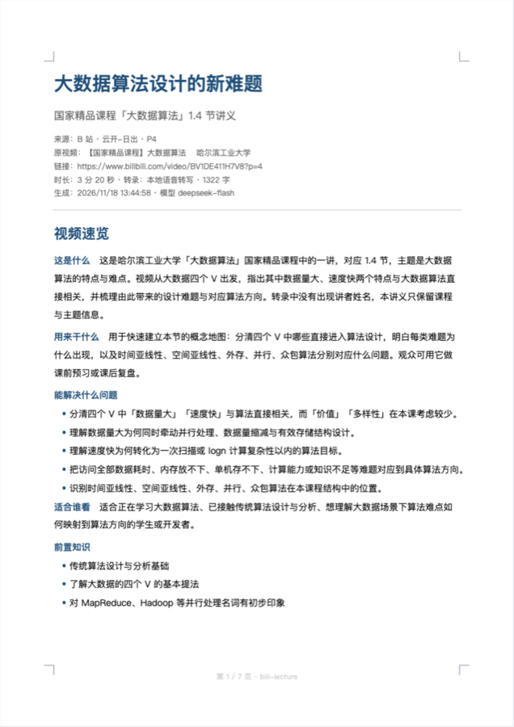

# B 站视频讲义（bili-lecture）

把一条 B 站视频链接变成一份能直接发出去的中文 Word 文档：**讲义 / 摘要 / SOP / 操作流程**。

文档开头固定有一节「视频速览」，先回答三件事：

1. **这是什么** —— 这是哪门课、谁在讲、覆盖什么范围；
2. **用来干什么** —— 看完或拿着它能完成什么；
3. **能解决什么问题** —— 3–5 条具体问题。

之后才是正文：讲义按章节展开定义、公式、例子与易错点；摘要结论先行；SOP 给可照做的步骤表、校验清单和异常处理；操作流程给按时间排序的步骤、分支判断和检查点。



## 安装

这是一个 DSH 插件包（Host-only bundle，无构建步骤）。

1. 克隆仓库到本地；
2. 在 DSH 的「插件」面板用 **Add plugin** 选择该目录安装，或在会话里让 Agent 用 `plugin_manager` 的 `install_bundle` 指向这个目录；
3. 插件行出现后确认已启用，工具 `bili_lecture` 即可在新会话中调用。

改名或移动目录后需要重新安装；插件代码改动后，在插件面板把这一行禁用再启用一次才会加载新代码。

## 用法

在会话里直接说，例如：

- 「用 bili_lecture 把 https://www.bilibili.com/video/BV1xx411c7xx?p=3 做成讲义」
- 「把这个 B 站链接整理成 SOP：<链接>」
- 「这条视频生成摘要，只要一页」

工具参数：

| 参数 | 说明 |
|---|---|
| `url` | 必填。视频链接、BV 号或 av 号，可带 `?p=2`。 |
| `kind` | `讲义`（默认）、`摘要`、`SOP`、`操作流程`。 |
| `pages` | `1`、`1-3`、`1,3,5` 或 `all`。默认单 P 视频取该 P，多 P 视频只取 P1。 |
| `outputDir` | 输出目录（相对工作目录），默认按类型建目录。 |
| `model` | 覆盖总结所用模型，`provider/model` 或模型名；默认跟随当前会话模型。 |

## 内容是怎么来的

1. **元数据**：B 站 `view` 接口取标题、UP 主、简介、分 P 与时长。
2. **字幕优先**：`player/v2` 接口发现 UP 主字幕或 AI 字幕时直接使用。
3. **没有字幕就本地转写**：`yt-dlp` 只下载音轨 → `ffmpeg` 转 16 kHz 单声道 WAV → `faster-whisper` 逐段识别（默认 `large-v3-turbo`，CPU 运行，完全离线）。
4. **总结**：当前会话模型分两阶段工作——长转录先去噪提炼笔记，再按文档类型生成结构化 JSON。
5. **排版**：插件内置零依赖的 OOXML 写出器，生成带页脚页码、表格、要点框、代码块和中文排版的 `.docx`。

转录结果缓存在工作目录 `.bili-lecture-cache/<BV号>/pN.json`，同一分 P 再跑一次不会重复转写。

## 前置条件

- 能访问 `api.bilibili.com`（以及字幕 CDN、音视频 CDN）。
- 本机有 `ffmpeg`。
- Python 环境里装了 `faster-whisper` 和 `yt-dlp`：默认找 `<工作目录>/.venv/bin/python`，也可以在插件配置里指定 `pythonPath`。
- 首次使用某个 whisper 模型时需要下载模型文件。

## 插件配置

全部可省略；需要覆盖时，在 profile 的补丁里给这一行加 `config`：

```yaml
- id: bili-lecture
  config:
    pythonPath: /path/to/.venv/bin/python
    whisperModel: large-v3-turbo
```

| 键 | 默认 | 说明 |
|---|---|---|
| `pythonPath` | 空 | 指定 Python 解释器；空则自动探测 `<工作目录>/.venv`。 |
| `ffmpegPath` | 空 | 指定 ffmpeg 可执行文件；空则按 PATH 与常见目录探测。 |
| `whisperModel` | `large-v3-turbo` | faster-whisper 模型名；会优先复用 `<工作目录>/.models` 的缓存。 |
| `whisperThreads` | `0` | CPU 线程数，0 表示自动。 |
| `cacheDir` | 空 | 转录缓存目录，空则用 `<工作目录>/.bili-lecture-cache`。 |

## 已知限制

- 没有字幕的视频需要本地转写，耗时大约是视频时长的 1–2 倍；`pages=all` 处理多 P 长课会很久。
- 转录是机器识别，专业名词、数字可能出错；文档末尾会写明这一点，关键结论请对照原视频。
- 只支持 B 站单个视频的分 P，不处理番剧、直播回放、付费课程等需要登录或 DRM 的内容。
- 生成质量取决于当前会话模型；模型调用失败时会退回「转录整理版」并在文档里标注，不会假装总结成功。
- 插件写入位置限定在工作目录内（缓存、输出目录）。

## 许可证

[MIT](LICENSE)。插件图标为原创 SVG。
